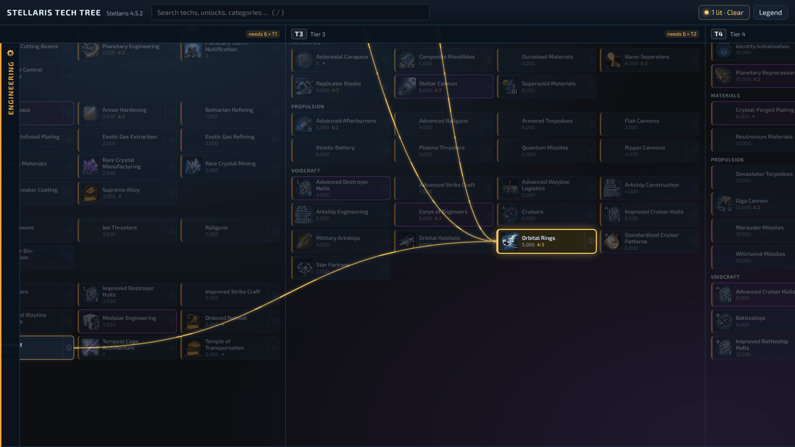
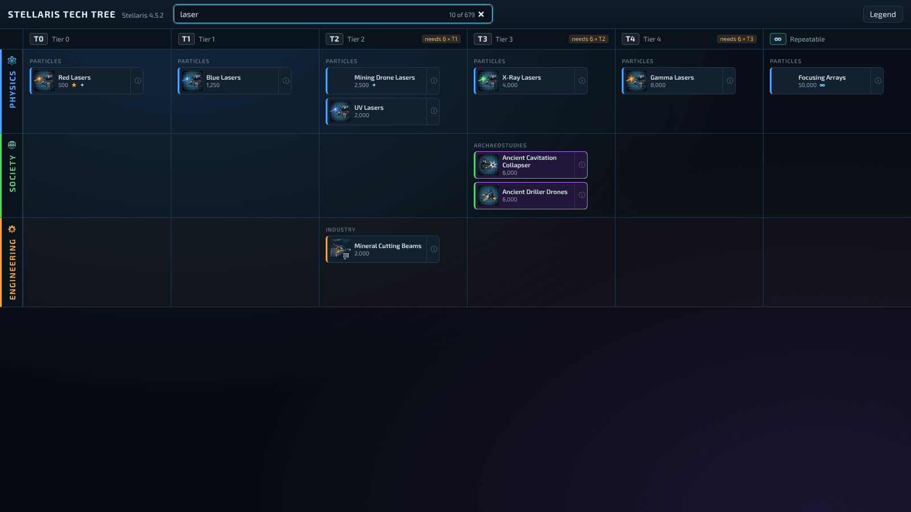

# Stellaris Tech Tree

An interactive Stellaris technology tree that finally shows the whole picture: every prerequisite, the requirements the game hides, and the tier gates that decide when a tech can even appear.

**Live site:** https://ythibos.github.io/Stellaris-Tech-Tree/ (goes live with the first public release)



## Why another tech tree?

The original Stellaris Tech Tree has been the go-to reference for years, and this project would not exist without it (see [Credits](#credits)).
It draws techs as a strict tree, though, so a tech that needs two or three others only ever shows one of them.

This version is built around the questions you actually ask mid-campaign:

- **What do I need for this?**
  Every prerequisite is drawn, not just the first.
  Orbital Rings needs Starhold, Galactic Administration and Ceramo-Metal Infrastructure, and all three are drawn.
  Requirements the game tucks away in a tech's availability conditions count too: Synaptic Cogitator also needs Scalable Reservoir Computing, which no prerequisite list mentions.
- **When can it even show up?**
  Techs sit in columns by their real tier, T0 to T5, with repeatables in their own column.
  Each tier shows how many techs of the previous tier the game wants first.
- **Where is that tech?**
  Search hides everything that doesn't match as you type.
- **Why am I never offered it?**
  Every tech lists its availability conditions and draw-chance modifiers in plain English, with the game's own script one click away.

## Using the tree

| To                                    | Do this                                                             |
| ------------------------------------- | ------------------------------------------------------------------- |
| Keep its whole requirement path lit   | Click it; click it again to switch it off                           |
| Plan towards several goals at once    | Click several techs; their paths combine                            |
| Read a tech's details                 | Click the ⓘ on its card                                             |
| Find a tech                           | Type in the search box, or press `/`                                |
| Clear search, details, then lit paths | Press `Esc`                                                         |
| Switch mods on or off                 | Click **Mods**, find a mod by name and tick or untick it            |
| Find every tech from one mod          | Type part of the mod's name in the search box                       |
| Share exactly what you're looking at  | Copy the page address; it remembers your search, lit techs and mods |

Purple cards are rare techs and red cards dangerous ones, as in the game.
Markers on a card: ★ starting tech, ✦ never drawn (granted by events and similar), ∞ repeatable, ⇇ more than one requirement, ✎ changed by a mod, ! needs a tech that is not loaded (for example from a mod you switched off).

## Mods

The tree includes every mod in your playset that touches technology: mods that add techs, like Gigastructural Engineering, Ancient Cache of Technologies or Guilli's Technologies, mods that change the game's techs, and mods that give existing techs new unlocks.
Each one can be switched off in the **Mods** list, and the tree rebuilds itself as the game would load it.
When a mod changes a tech, the tech's details say which mod and what changed, such as a new requirement or a higher cost.

The game decides conflicts the same way here as in game: a mod file with the same name as an earlier one replaces it, and when two files define the same tech, the file whose name sorts last wins.



## Coming next

1. **Your campaign** - mark what you have researched, by importing a save file, by marking a tech with everything before it, or a whole tier at once, then hide what's done.
2. **Older versions** - pick an earlier game patch.

## Updating the data for your own game

The tree is built from your own Stellaris files, so it can always match the patch you play.
You don't need to be a programmer to update it; these steps take about ten minutes the first time.

1. Install **Node.js** (the "LTS" version) from [nodejs.org](https://nodejs.org).
2. Download this project: on GitHub, click **Code** and then **Download ZIP**, and unzip it anywhere.
3. Open a terminal in the unzipped folder.
   On Windows, right-click inside the folder in Explorer and choose **Open in Terminal**.
   On macOS, right-click the folder in Finder and choose **New Terminal at Folder**.
4. Install the project's tools (only needed once):

   ```sh
   npm install
   ```

5. Extract the tech tree from your game:

   ```sh
   npm run extract
   ```

   It finds Stellaris in the usual Steam folders, reads the mods you last enabled in the Stellaris launcher, in their load order, and reports what it read.
   Start the game once from the launcher with the playset you want, so the launcher records it.
   To leave mods out, add `-- --no-mods`.
   If it can't find the game, tell it where Stellaris is installed:

   ```sh
   npm run extract -- --game "D:\SteamLibrary\steamapps\common\Stellaris"
   ```

6. Look at the result on your own computer:

   ```sh
   npm run dev
   ```

   Then open the address it prints, usually http://localhost:5173.

The extracted data lands in `public/data/<game version>/`.
Running the extraction again after a patch replaces that version's data.

## Credits

This project stands on the shoulders of the original Stellaris Tech Tree.
A big thank you to:

- **turanar** (Richard Simões) for [the original Stellaris Tech Tree](https://github.com/turanar/stellaris-tech-tree) and its extraction tool, which showed how useful a browsable tree is and inspired this one.
- **BloodStainedCrow** for [keeping that tree up to date](https://github.com/BloodStainedCrow/stellaris-tech-tree) through Stellaris 4.3 with [its extractor](https://github.com/BloodStainedCrow/stellaris-technology).

Stellaris and all of its text and icons belong to Paradox Interactive.
This is an unofficial fan project, not affiliated with or endorsed by Paradox Interactive.

## For developers

```sh
npm install        # install tools
npm run dev        # site with live reload
npm test           # unit and extraction tests
npm run lint       # ESLint and Prettier
npm run typecheck  # TypeScript and Svelte checks
npm run build      # production site in dist/
npm run extract    # read game files into public/data
```

- `src/domain` - the tech model shared by the site and the extractor: technologies, tiers, tier gates and requirement paths.
- `src/script` - a reader and writer for Paradox's script format.
- `src/extraction` - the command-line extractor.
- `src/site` - the Svelte site.
- `docs/specification.md` - what the project sets out to build, milestone by milestone.

Every pull request runs lint, type checks, tests and a build.
Merges to `master` publish the site to GitHub Pages once the repository is public.
